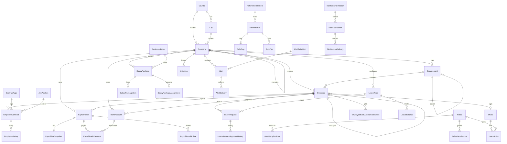

# Schéma base de données Payzen — Tables par module

> Source de vérité : `AppDbContext`, configurations Fluent API (`Persistence/Configurations/**`) et entités Domain.  
> ~95 tables. Comportement de suppression par défaut : **Restrict**, sauf mentions Cascade / SetNull.  
> Soft-delete global (`DeletedAt`) appliqué via filtre EF sur les entités concernées.

---

## Vue d’ensemble des modules

| Module | Nb tables (approx.) | Rôle |
|--------|---------------------|------|
| Auth | 6 | Utilisateurs, rôles, permissions, invitations |
| Company | 7 | Sociétés, org., contrats, calendriers |
| Referentiel | 10 | Lookups partagés (pays, villes, genres…) |
| Employee | 17 | RH employé, contrats, salaires, pointage |
| Leave | 10 | Congés, soldes, demandes |
| Payroll | 13 + paiements | Résultats de paie, packages, CNSS, IR |
| Payroll Referentiel | 15 | Barèmes, règles, éléments de paie |
| BankAccount | 2 | Comptes bancaires & allocations |
| Alert | 11 | Alertes runtime & préférences |
| Notification | 7 | Inbox notifications |
| Events | 2 | Logs d’audit (sans FK contraintes) |

### Hubs principaux

| Hub | Modules aval |
|-----|--------------|
| **Company** | Employee, Leave, Payroll, BankAccount, Alert, Notification, Auth (Invitation), Ancienneté |
| **Employee** | Auth (Users), Leave, Payroll, BankAccount, Départements (Manager), absences/OT |
| **Users / Roles** | Auth, Alert, Notification |
| **Referentiel** | Company (geo), Employee (démographie), ContractType, Overtime |
| **Payroll Referentiel** | SalaryPackage, ReferentielElement → règles |

---

## Diagramme ER inter-modules



---

## 1. Auth

| Table | Entité | Relations |
|-------|--------|-----------|
| `Users` | Users | FK `EmployeeId` → `Employees` (**SetNull**). Collection : `UsersRoles` |
| `Roles` | Roles | Lookup. Lié via `UsersRoles`, `RolesPermissions`, `AlertRecipientRoles`, `Invitations` |
| `Permissions` | Permissions | Lookup. Lié via `RolesPermissions` |
| `RolesPermissions` | RolesPermissions | FK `RoleId` → `Roles` ; FK `PermissionId` → `Permissions` |
| `UsersRoles` | UsersRoles | FK `UserId` → `Users` ; FK `RoleId` → `Roles` |
| `Invitations` | Invitation | FK `CompanyId` → `Companies` ; FK `RoleId` → `Roles` |

```
Roles ──┬── RolesPermissions ── Permissions
        ├── UsersRoles ──────── Users ──(SetNull)── Employees
        └── Invitations ─────── Companies
```

---

## 2. Company

| Table | Entité | Relations |
|-------|--------|-----------|
| `Companies` | Company | FK `CityId` → `Cities` ; FK `CountryId` → `Countries` ; self-FK `ManagedByCompanyId` → `Companies`. Collections : `Employees`, `Documents`, `BankAccounts`, `ManagedCompanies` |
| `Departements` | Departement | FK `CompanyId` → `Companies` (**Cascade**) ; self-FK `ParentDepartementId` → `Departements` ; FK `ManagerId` → `Employees` (**SetNull**). Collection : `Employees` |
| `ContractTypes` | ContractType | FK `CompanyId` → `Companies` ; FK `LegalContractTypeId` → `LegalContractTypes` (**SetNull**) ; FK `StateEmploymentProgramId` → `StateEmploymentPrograms` (**SetNull**) |
| `JobPositions` | JobPosition | FK `CompanyId` → `Companies`. Collection : `EmployeeContracts` |
| `Holidays` | Holiday | FK `CompanyId` → `Companies` ; FK `CountryId` → `Countries` |
| `WorkingCalendars` | WorkingCalendar | FK `CompanyId` → `Companies` |
| `CompanyDocuments` | CompanyDocument | FK `CompanyId` → `Companies` |

```
Countries ── Cities
    │          │
    └──── Companies ◄── ManagedByCompanyId (self)
              │
              ├── Departements (Cascade) ◄── ParentDepartementId (self)
              │         └── ManagerId → Employees
              ├── ContractTypes → LegalContractTypes, StateEmploymentPrograms
              ├── JobPositions
              ├── Holidays, WorkingCalendars
              └── CompanyDocuments
```

---

## 3. Referentiel (lookups partagés)

| Table | Entité | Relations / usage |
|-------|--------|-------------------|
| `Countries` | Country | Collections : `Cities`, `Companies`, `Holidays`, `Employees`, `EmployeeAddresses` |
| `Cities` | City | FK `CountryId` → `Countries`. Utilisé par Company, EmployeeAddress |
| `Genders` | Gender | Employee, Child, Spouse |
| `Statuses` | Status | Employee |
| `EducationLevels` | EducationLevel | Employee |
| `MaritalStatuses` | MaritalStatus | Employee |
| `Nationalities` | Nationality | Employee |
| `LegalContractTypes` | LegalContractType | ContractType |
| `StateEmploymentPrograms` | StateEmploymentProgram | ContractType |
| `OvertimeRateRules` | OvertimeRateRule | Collection : `EmployeeOvertimes` |

> **Note :** coll. `Country.Employees` / `Country.EmployeeAddresses` génèrent des colonnes shadow `CountryId` sur `Employees` et `EmployeeAddresses` (présentes en BDD, absentes des classes entité).

---

## 4. Employee

| Table | Entité | Relations |
|-------|--------|-----------|
| `Employees` | Employee | FK `CompanyId` → `Companies` ; self-FK `ManagerId` → `Employees` ; FK `DepartementId` → `Departements` (**SetNull**) ; FK demographiques (`StatusId`, `GenderId`, `NationalityId`, `EducationLevelId`, `MaritalStatusId`) **SetNull** ; FK `CategoryId` → `EmployeeCategories` (**SetNull**) ; FK `BankAccountId` → `BankAccounts` (**SetNull**). Collections : contrats, salaires, adresses, docs, pointages, conjoints, enfants |
| `EmployeeCategories` | EmployeeCategory | FK `CompanyId` → `Companies` |
| `EmployeeContracts` | EmployeeContract | FK `EmployeeId`, `CompanyId`, `JobPositionId`, `ContractTypeId` |
| `EmployeeSalaries` | EmployeeSalary | FK `EmployeeId` ; FK `ContractId` → `EmployeeContracts` |
| `EmployeeSalaryComponents` | EmployeeSalaryComponent | FK `EmployeeSalaryId` → `EmployeeSalaries` |
| `EmployeeAddresses` | EmployeeAddress | FK `EmployeeId` ; FK `CityId` → `Cities` (+ shadow CountryId) |
| `EmployeeDocuments` | EmployeeDocument | FK `EmployeeId` |
| `EmployeeAttendances` | EmployeeAttendance | FK `EmployeeId`. Collection : `Breaks` |
| `EmployeeAttendanceBreaks` | EmployeeAttendanceBreak | FK `EmployeeAttendanceId` |
| `EmployeeAbsences` | EmployeeAbsence | FK `EmployeeId` |
| `EmployeeChildren` | EmployeeChild | FK `EmployeeId` ; FK `GenderId` (**SetNull**) |
| `EmployeeSpouses` | EmployeeSpouse | FK `EmployeeId` ; FK `GenderId` (**SetNull**) |
| `EmployeeOvertimes` | EmployeeOvertime | FK `EmployeeId` ; FK `HolidayId` (**SetNull**) ; FK `RateRuleId` → `OvertimeRateRules` (**SetNull**) |
| `EmployeeMonthlyAbsenceSummaries` | EmployeeMonthlyAbsenceSummary | FK `EmployeeId` (unique EmployeeId+Year+Month) |
| `EmployeeMonthlyLeaveSummaries` | EmployeeMonthlyLeaveSummary | FK `EmployeeId` (unique période) |
| `EmployeeMonthlyOvertimeSummaries` | EmployeeMonthlyOvertimeSummary | FK `EmployeeId` (unique période) |
| `EmployeeMonthlyWorkedDaysSummaries` | EmployeeMonthlyWorkedDaysSummary | FK `EmployeeId` (unique période) |

```
Companies ── Employees ◄── ManagerId (self)
                │
                ├── EmployeeCategories
                ├── EmployeeContracts → JobPositions, ContractTypes
                │         └── EmployeeSalaries → EmployeeSalaryComponents
                ├── EmployeeAddresses → Cities
                ├── EmployeeDocuments
                ├── EmployeeAttendances → EmployeeAttendanceBreaks
                ├── EmployeeAbsences
                ├── EmployeeChildren / EmployeeSpouses → Genders
                ├── EmployeeOvertimes → Holidays, OvertimeRateRules
                └── *Monthly*Summaries
```

---

## 5. Leave

| Table | Entité | Relations |
|-------|--------|-----------|
| `LeaveTypes` | LeaveType | FK `CompanyId` → `Companies` (nullable). Collections : `Policies`, `LegalRules` |
| `LeaveTypePolicies` | LeaveTypePolicy | FK `CompanyId` ; FK `LeaveTypeId` |
| `LeaveTypeLegalRules` | LeaveTypeLegalRule | FK `LeaveTypeId` |
| `LeaveRequests` | LeaveRequest | FK `EmployeeId`, `CompanyId`, `LeaveTypeId` ; FK `LegalRuleId`, `PolicyId` (**SetNull**). Collections : historique, exemptions, pièces jointes |
| `LeaveRequestApprovalHistories` | LeaveRequestApprovalHistory | FK `LeaveRequestId` |
| `LeaveRequestExemptions` | LeaveRequestExemption | FK `LeaveRequestId` ; FK `HolidayId`, `EmployeeAbsenceId` (**SetNull**) |
| `LeaveRequestAttachments` | LeaveRequestAttachment | FK `LeaveRequestId` |
| `LeaveAuditLogs` | LeaveAuditLog | FK `CompanyId` ; FK `EmployeeId`, `LeaveRequestId` (**SetNull**) |
| `LeaveBalances` | LeaveBalance | FK `EmployeeId`, `CompanyId`, `LeaveTypeId` (unique Employee+LeaveType+Year+Month) |
| `LeaveCarryOverAgreements` | LeaveCarryOverAgreement | FK `EmployeeId`, `CompanyId`, `LeaveTypeId` |

```
Companies / Employees
        │
LeaveTypes ── LeaveTypePolicies
     │    └── LeaveTypeLegalRules
     │
     ├── LeaveRequests ── ApprovalHistories
     │         ├── Exemptions → Holidays, EmployeeAbsences
     │         └── Attachments
     ├── LeaveBalances
     ├── LeaveCarryOverAgreements
     └── LeaveAuditLogs
```

---

## 6. Payroll

| Table | Entité | Relations |
|-------|--------|-----------|
| `PayrollResults` | PayrollResult | FK `EmployeeId`, `CompanyId`. Collections : `Primes`, `CalculationAuditSteps`, `BankPayments` |
| `PayrollResultPrimes` | PayrollResultPrime | FK `PayrollResultId` |
| `PayrollCalculationAuditSteps` | PayrollCalculationAuditStep | FK `PayrollResultId` |
| `PayrollCustomRules` | PayrollCustomRule | Colonne `CompanyId` — **pas de FK EF** |
| `SalaryPackages` | SalaryPackage | FK `CompanyId` ; FK `BusinessSectorId` → `BusinessSectors` |
| `SalaryPackageItems` | SalaryPackageItem | FK `SalaryPackageId` ; FK `PayComponentId`, `ReferentielElementId` (**SetNull**) |
| `SalaryPackageAssignments` | SalaryPackageAssignment | FK `SalaryPackageId`, `EmployeeId`, `ContractId`, `EmployeeSalaryId` |
| `PayComponents` | PayComponent | Catalogue global (pas de FK Company) |
| `SystemConstants` | SystemConstant | Lookup seedé |
| `IrTaxBrackets` | IrTaxBracket | Lookup seedé (barème IR) |
| `CnssPreetabliImports` | CnssPreetabliImport | FK `CompanyId`. Collection : `Lines` |
| `CnssPreetabliLines` | CnssPreetabliLine | FK `CnssPreetabliImportId` (**Cascade**) |
| `PayrollTaxSnapshots` | PayrollTaxSnapshot | 1:1 FK `PayrollResultId` (**Cascade**) |
| `PayrollBankPayments` | PayrollBankPayment | FK `PayrollResultId` (**Cascade**) ; FK `BankAccountId` → `BankAccounts` |

```
Employees / Companies
        │
PayrollResults ── Primes
     │         ├── CalculationAuditSteps
     │         ├── PayrollTaxSnapshots (1:1 Cascade)
     │         └── PayrollBankPayments → BankAccounts
     │
SalaryPackages → BusinessSectors
     ├── SalaryPackageItems → PayComponents, ReferentielElements
     └── SalaryPackageAssignments → Employees, Contracts, Salaries
     │
CnssPreetabliImports → CnssPreetabliLines (Cascade)
SystemConstants, IrTaxBrackets  (lookups)
PayrollCustomRules  (CompanyId sans FK)
```

---

## 7. Payroll Referentiel

| Table | Entité | Relations |
|-------|--------|-----------|
| `Authorities` | Authority | Collection : `ElementRules` |
| `ElementCategories` | ElementCategory | Collection : `Elements` |
| `EligibilityCriteria` | EligibilityCriteria | Utilisé par RulePercentage, RuleVariant |
| `LegalParameters` | LegalParameter | Utilisé par RuleFormula |
| `ReferentielElements` | ReferentielElement | FK `CategoryId` → `ElementCategories`. Collection : `Rules` |
| `ElementRules` | ElementRule | FK `ElementId` ; FK `AuthorityId`. 1:1 : Cap, Percentage, Formula, DualCap. Collections : Tiers, Variants |
| `RuleCaps` | RuleCap | 1:1 FK `RuleId` (**Cascade**) |
| `RulePercentages` | RulePercentage | 1:1 FK `RuleId` (**Cascade**) ; FK `EligibilityId` (**SetNull**) |
| `RuleFormulas` | RuleFormula | 1:1 FK `RuleId` (**Cascade**) ; FK `ParameterId` → `LegalParameters` |
| `RuleDualCaps` | RuleDualCap | 1:1 FK `RuleId` (**Cascade**) |
| `RuleTiers` | RuleTier | FK `RuleId` |
| `RuleVariants` | RuleVariant | FK `RuleId` ; FK `EligibilityId` (**SetNull**) |
| `AncienneteRateSets` | AncienneteRateSet | FK `CompanyId` ; self-FK `ClonedFromId`. Collection : `Rates` |
| `AncienneteRates` | AncienneteRate | FK `RateSetId` |
| `BusinessSectors` | BusinessSector | Collection : `SalaryPackages` |

```
ElementCategories ── ReferentielElements ── ElementRules ── Authorities
                                              │
                         ┌──── Cascade 1:1 ───┼── RuleCaps / Percentages / Formulas / DualCaps
                         │                    ├── RuleTiers
                         │                    └── RuleVariants → EligibilityCriteria
                         │
Companies ── AncienneteRateSets ◄── ClonedFromId ── AncienneteRates
BusinessSectors ── SalaryPackages
```

---

## 8. BankAccount

| Table | Entité | Relations |
|-------|--------|-----------|
| `BankAccounts` | BankAccount | FK `CompanyId` → `Companies` ; FK optionnel `EmployeeId` → `Employees`. Inverse : employés via `BankAccountId` (**SetNull**) |
| `EmployeeBankAccountAllocations` | EmployeeBankAccountAllocation | FK `EmployeeId` (**Cascade**) ; FK `BankAccountId` (**Cascade**) ; unique (EmployeeId, BankAccountId) |

```
Companies ── BankAccounts ◄── Employees.BankAccountId (défaut, SetNull)
                  │
                  └── EmployeeBankAccountAllocations ← Employees (Cascade)
                  └── PayrollBankPayments
```

---

## 9. Alert

| Table | Entité | Relations |
|-------|--------|-----------|
| `AlertCategories` | AlertCategory | Collection : `Definitions` |
| `AlertSeverities` | AlertSeverity | Collections : `Definitions`, `Alerts` |
| `AlertDefinitions` | AlertDefinition | FK `CategoryId`, `SeverityId` |
| `AlertRecipientRoles` | AlertRecipientRole | FK `DefinitionId` (**Cascade**) ; FK `RoleId` → `Roles` |
| `CompanyAlertPreferences` | CompanyAlertPreference | FK `CompanyId`, `DefinitionId` ; FK `UpdatedByUserId` → `Users` |
| `Alerts` | Alert | FK `CompanyId`, `DefinitionId`, `SeverityId` ; FK users (Assigned / Acknowledged / Resolved). Soft polymorphic : `EntityType` + `EntityId` |
| `AlertUserPreferences` | AlertUserPreference | FK `CompanyId`, `UserId`, `DefinitionId` |
| `AlertUserPreferenceAudits` | AlertUserPreferenceAudit | FK `PreferenceId` (**Cascade**) |
| `AlertAuditLogs` | AlertAuditLog | FK `AlertId` (**Cascade**) ; FK `UserId` |
| `AlertDeliveries` | AlertDelivery | FK `AlertId` (**Cascade**) ; FK `UserId` |
| `AlertRuleExecutionLogs` | AlertRuleExecutionLog | FK `DefinitionId`, `CompanyId` |

```
AlertCategories / AlertSeverities
        └── AlertDefinitions ── AlertRecipientRoles → Roles
                │
                ├── CompanyAlertPreferences → Companies, Users
                ├── AlertUserPreferences → Audits (Cascade)
                ├── AlertRuleExecutionLogs
                └── Alerts → AuditLogs, Deliveries (Cascade)
                     └── EntityType/EntityId (polymorphe, sans FK)
```

---

## 10. Notification

| Table | Entité | Relations |
|-------|--------|-----------|
| `NotificationCategories` | NotificationCategory | Collection : `Definitions` |
| `NotificationDefinitions` | NotificationDefinition | FK `CategoryId` |
| `CompanyNotificationPreferences` | CompanyNotificationPreference | FK `CompanyId`, `DefinitionId` |
| `NotificationUserPreferences` | NotificationUserPreference | FK `CompanyId`, `UserId`, `DefinitionId` |
| `Notifications` | **UserNotification** | FK `CompanyId`, `UserId`, `DefinitionId`. Soft link Alert via `SourceType` / `SourceId` |
| `NotificationDeliveries` | NotificationDelivery | FK `NotificationId` (**Cascade**) ; FK `UserId` |
| `NotificationAuditLogs` | NotificationAuditLog | FK `NotificationId` (**Cascade**) ; FK `UserId` |

> **Renommage :** entité `UserNotification` → table **`Notifications`**.

```
NotificationCategories ── NotificationDefinitions
        │
        ├── CompanyNotificationPreferences
        ├── NotificationUserPreferences
        └── Notifications (UserNotification)
                ├── NotificationDeliveries (Cascade)
                ├── NotificationAuditLogs (Cascade)
                └── SourceType/SourceId → Alert (soft, sans FK)
```

---

## 11. Events (audit)

| Table | Entité | Relations |
|-------|--------|-----------|
| `EmployeeEventLogs` | EmployeeEventLog | Scalaire `employeeId` — **pas de FK** |
| `CompanyEventLogs` | CompanyEventLog | Scalaires `companyId`, `employeeId` — **pas de FK** |

Configurés dans `ReferentielConfigurations.cs`.

---

## Points d’attention

1. **Shadow `CountryId`** sur `Employees` et `EmployeeAddresses` (navigation `Country` collection).
2. **IDs sans contrainte FK EF :** `PayrollCustomRules.CompanyId`, `EmployeeEventLogs.employeeId`, `CompanyEventLogs.companyId/employeeId`.
3. **Références polymorphes (soft) :** `Alerts.EntityType` + `EntityId` ; `Notifications.SourceType` + `SourceId`.
4. **Soft-delete :** filtre global `DeletedAt IS NULL` dans `AppDbContext.OnModelCreating`.
5. **Configs :** `backend/Payzen.Infrastructure/Persistence/Configurations/{Module}/`.

---

*Généré à partir du modèle EF Core Payzen — à mettre à jour après migrations majeures.*
